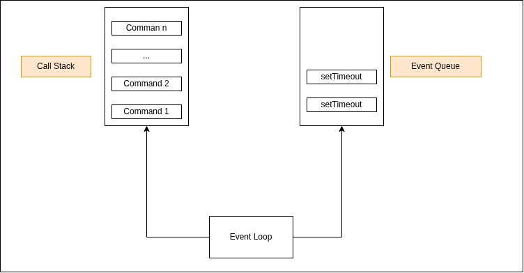

# [JavaScript Execution: Call Stack & Event Loop](https://www.educative.io/courses/javascript-interview-handbook/javascript-execution-call-stack-event-loop)

Explore how JavaScript executes code using the call stack, event loop, and event queue.

JavaScript is single-threaded, meaning it can only run one command at a time. Due to this, commands are not run in parallel. Because the execution happens line-by-line, each command is considered synchronous hence blocking.

## Call Stack, Event table & Event Queue
As you know, the `call stack stores all your running JavaScript code`. The interpreter reads the code line-by-line, pushes each statement into the call stack one-by-one, and pops them once they execute. However, `if the statement is asynchronous, it is removed from the call stack and forwarded to the event table.`This table is responsible for moving the asynchronous code to the event queue after a specified time. Here the statement waits for execution.

**This brings us to the question. When will the statements from the event queue execute?**

## Event Loop
The `event loop is responsible for keeping check of both the call stack and the event queue.` It keeps checking if all the statements from the call stack have finished execution; that is, if the call stack is empty. If so, it pops the statement from the event queue (if present) to the call stack to execute.

---

**Note**: 

_All synchronous statements execute first, and only then can the asynchronous ones execute._

_Even though the time delay is passed in setTimeout, it does not necessarily mean the callback will execute right after. That’ll only happen once all the commands in the call stack execute._